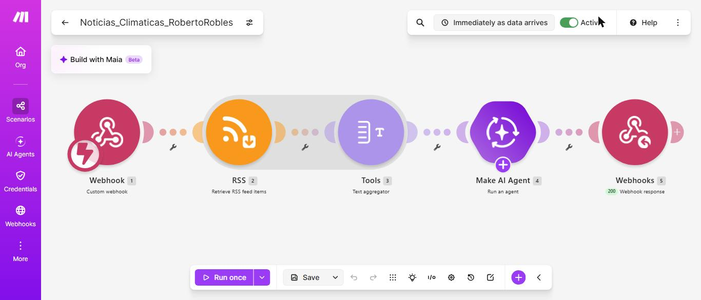
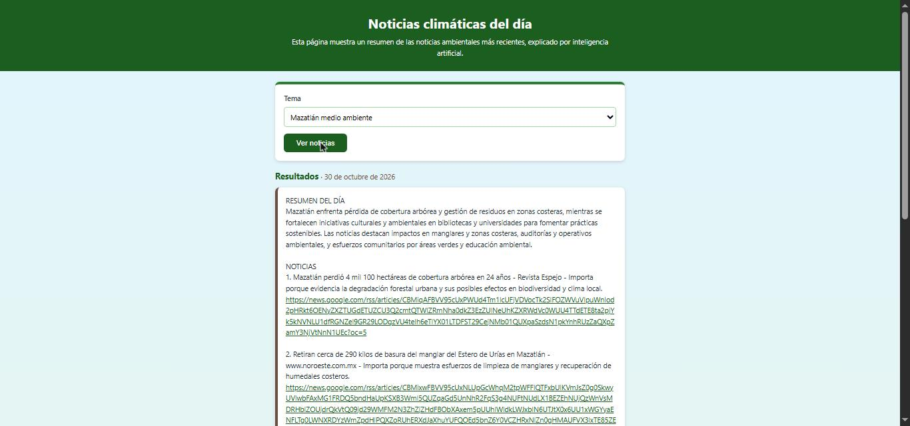
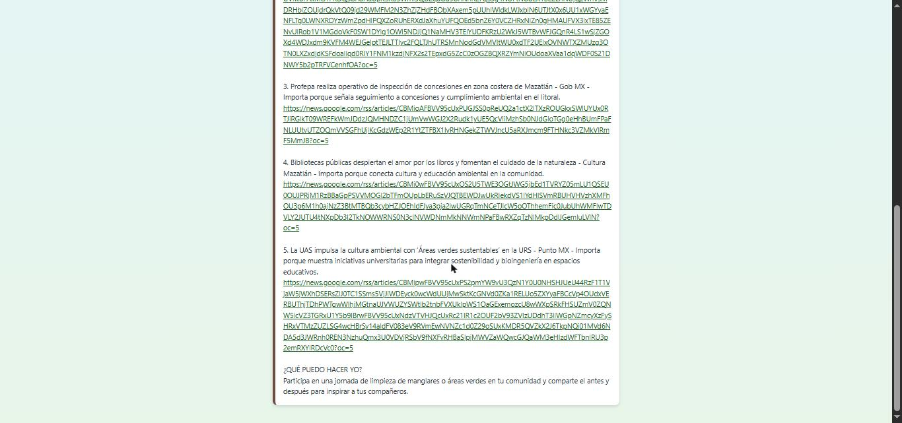

# Práctica 3.5 – Noticias climáticas del día

| Dato | Valor |
|---|---|
| Estudiante | Roberto Carlos Robles Campos |
| Escuela | Tecnológico Nacional de México – Instituto Tecnológico de Mazatlán |
| Materia | Desarrollo Sustentable (ACD-0908) |
| Práctica | 3.5-P1 Página web "Noticias climáticas del día" |

**Página publicada:** https://roblescamposcarlos-beep.github.io/Noticias_Climaticas_Hoy/
**Código:** [`codigo/index.html`](codigo/index.html) (la misma página; una copia está en la raíz para que GitHub Pages la publique) · **Escenario de Make:** [`codigo/blueprint.json`](codigo/blueprint.json) · **Resultados (PDF):** [`resultados/Resultados.pdf`](resultados/Resultados.pdf)

## 1. Objetivo
Construir sin programar una herramienta de difusión ambiental que obtenga noticias recientes mediante RSS, las resuma con IA y las muestre en una página web, verificando que los resúmenes sean fieles a sus fuentes.

## 2. Temas elegidos
Seis temas, uno o más de cada bloque (A–D) y dos locales (E). Todos tienen noticias recientes en Google News.

| Bloque | Tema |
|---|---|
| A. Cambio climático | cambio climático |
| B. Impacto humano | contaminación del mar |
| C. Consumo | plásticos de un solo uso |
| D. Energía y soluciones | energías renovables México |
| E. Local | manglares Sinaloa |
| E. Local | Mazatlán medio ambiente |

## 3. Cómo funciona
Flujo: **Página web → Make (Webhook → RSS → Text aggregator → Make AI Agent → Webhook Response) → Página web**.

| # | Módulo | Configuración |
|---|---|---|
| 1 | Webhooks → Custom webhook | Recibe el campo `tema` que envía la página |
| 2 | RSS → Retrieve RSS feed items | URL `https://news.google.com/rss/search?q={{encodeURL(1.tema)}}&hl=es-419&gl=MX&ceid=MX:es-419`, máximo 5 noticias. `encodeURL` hace que temas con espacios o acentos funcionen. |
| 3 | Tools → Text aggregator | Junta las 5 noticias en un solo texto (`Título`, `Fecha`, `Enlace`). Sin él, la IA correría 5 veces y gastaría 5 veces más créditos. |
| 4 | Make AI Agent | Conexión *Make's AI Provider*, sin Knowledge. Input: `Tema` + `Noticias` agregadas. Instrucciones: divulgador ambiental, usar únicamente la información de las noticias, texto plano y formato fijo (RESUMEN DEL DÍA, NOTICIAS, ¿QUÉ PUEDO HACER YO?). |
| 5 | Webhooks → Webhook response | Status `200`, body = respuesta del agente, headers `Content-Type: text/plain; charset=utf-8` y `Access-Control-Allow-Origin: *` |

El escenario se ejecuta **Immediately** (cada vez que llega una consulta).

**La página** (`index.html`, un solo archivo con HTML, CSS y JavaScript, sin librerías) tiene una lista "Tema" con los 6 temas y el botón "Ver noticias". Envía el tema por POST con `fetch` y `URLSearchParams` (un solo campo, `tema`), muestra "Buscando y resumiendo noticias..." y desactiva el botón mientras espera, pone la fecha de hoy junto a "Resultados", respeta los saltos de línea (`white-space: pre-line`), convierte en enlaces clicables (otra pestaña) las líneas que empiezan con `http`, y si hay un error muestra "No se pudieron obtener las noticias, intenta de nuevo."

## 4. Pruebas de los 6 temas
Se probaron los 6 temas con el escenario activo el 30 de octubre de 2026. Los seis devolvieron 5 noticias con su resumen y una acción para el estudiante.

| Tema | Noticias en Google News* | De los últimos 7 días* | Las 5 noticias que mostró la página |
|---|---|---|---|
| cambio climático | 101 | 97 | Senado de México, EL PAÍS (2), El Financiero, Sin Embargo |
| contaminación del mar | 59 | 4 | National Geographic España, Infobae (Panamá), UNEP, ONU, BBVA |
| plásticos de un solo uso | 49 | 4 | El Tiempo, La Jornada Zacatecas, Excélsior, La Prensa, La Nación |
| energías renovables México | 100 | 20 | Imagen Radio, El Heraldo de México, Energía a Debate, Energía Estratégica, Gaceta UNAM |
| manglares Sinaloa | 76 | 2 | La Jornada, Infobae, Sector Primario Informativo, Revista Espejo, El Sol de México |
| Mazatlán medio ambiente | 57 | 4 | Revista Espejo, Noroeste, Gob MX (Profepa), Cultura Mazatlán, El Sol de México |

\*Conteo propio al pedir el mismo RSS de Google News a las mismas horas; el feed devuelve como máximo unas 100 noticias. La página solo muestra 5 (límite del módulo RSS).

### Errores que se vieron en las respuestas
- **Noticia número 6 inventada.** En 3 de los 6 temas (plásticos, energías renovables y manglares) la IA agregó una sexta noticia que no existe: el RSS solo trae 5. Por ejemplo, en manglares puso "Título: No especificado como noticia individual adicional en la lista", y le repitió el enlace de otra noticia. Esto rompe la instrucción de no agregar noticias que no estén en la lista.
- **Formato inconsistente.** En plásticos agregó la fecha de cada noticia y en los demás temas no; la sangría de los enlaces también cambia de un tema a otro.
- **Palabras repetidas.** En Mazatlán dijo "manglares, manglares" en una de las primeras pruebas.

## 5. Verificación contra las noticias originales
De tres temas distintos se abrió una noticia original y se comparó con lo que dijo la IA.

| Tema | Noticia | Lo que dijo la IA | Lo que dice la fuente | ¿Es fiel? |
|---|---|---|---|---|
| plásticos de un solo uso | La Jornada Zacatecas, 23/10/2026: [De un solo uso, 50 % de los plásticos que se generan en el mundo](https://ljz.mx/23/10/2026/de-un-solo-uso-50-de-los-plasticos-que-se-generan-en-el-mundo/) | "Subraya la magnitud del problema y la necesidad de reducir la dependencia de este tipo de plásticos." Y en el resumen del día: "hay evidencia de que la mitad de los plásticos generados son de un solo uso". | La nota trata de **microplásticos**, a partir de una conferencia con especialistas de la UNAM y la Universidad La Salle. Da la cifra del 50 % en el titular, pero **no cita fuente, estudio ni año**. No menciona impuestos ni políticas públicas. | **Parcialmente.** La cifra es correcta, pero la IA no dijo que el enfoque era microplásticos y habló de "evidencia" cuando la nota no cita ninguna. |
| Mazatlán medio ambiente | Revista Espejo, 25/10/2026: [Mazatlán perdió 4 mil 100 hectáreas de cobertura arbórea en 24 años](https://revistaespejo.com/2026/10/25/mazatlan-perdio-4-mil-100-hectareas-de-cobertura-arborea-en-24-anos/) | "Evidencia la magnitud de la pérdida de bosques urbanos y sus impactos en temperatura, biodiversidad y servicios ecosistémicos." | 4,100 ha perdidas entre 2001 y 2025, según un análisis de Espejo con Global Forest Watch, asociadas a 1.3 millones de toneladas de CO₂ equivalente. **No habla de temperatura.** De biodiversidad solo hay un comentario de un ambientalista sobre menos aves, sin cifras. No usa "servicios ecosistémicos"; sí menciona erosión y deterioro de suelos. | **Parcialmente.** La cifra es fiel, pero la IA agregó impactos (temperatura, servicios ecosistémicos) que la nota no dice. |
| energías renovables México | Imagen Radio, 29/10/2026: [Sener prevé elevar a 38 % la generación de energía renovable en México para 2030](https://www.imagenradio.com.mx/noticias/sener-preve-elevar-38-generacion-energia-renovable-mexico-para-2030) | "Muestra una meta oficial de expansión de la generación limpia en el país." | El 38 % del total nacional de electricidad en 2030 (14 puntos porcentuales más) lo anunció el subsecretario de Planeación y Transición Energética de Sener como "meta sexenal". No cita un decreto ni un documento formal. | **Sí.** La cifra y el carácter de meta de la Secretaría de Energía coinciden. |

**Otra observación (solo del titular).** En el tema de plásticos, la IA resumió la noticia de Excélsior "Jesús Sesma propone eliminar plásticos de un solo uso en envíos de plataformas digitales" como "iniciativas privadas que buscan reducir residuos plásticos". Pero quien propone es un diputado, es decir, una propuesta legislativa y no una iniciativa privada. No se pudo abrir esa nota: una nota relacionada de Excélsior sobre el mismo diputado (13/07/2026) lo describe como diputado local del PVEM en el Congreso de la Ciudad de México que presentó una iniciativa de ley; no se confirmó si es la misma nota.

**Limitación de esta verificación:** la nota de La Jornada Zacatecas era muy larga y la herramienta de lectura devolvió un resumen y no el texto literal; las cifras citadas arriba (50 %, sin fuente ni impuestos) deben tomarse con esa cautela.

## 6. Consumo de créditos
En el historial del escenario, cada consulta con noticias consumió entre **5.71 y 6.49 créditos** (≈ 6.0), con **5 operaciones** (webhook, RSS, Text aggregator, AI Agent y Webhook response) y entre 9 y 19 segundos de duración. Una consulta sin noticias (el RSS devolvió cero) gastó ≈ 5.1 créditos, porque los módulos corren aunque no haya noticias.

## Video de la prueba en vivo
*(pendiente)*

## 7. Preguntas de reflexión

**1. ¿Qué tema tuvo más noticias recientes y cuál menos? ¿Qué dice eso sobre la atención que los medios dan a cada problema?**
"Cambio climático" fue el tema con más noticias recientes: el RSS devolvió 101 y 97 eran de los últimos 7 días. Le sigue "energías renovables México" (100 noticias, 20 de la última semana). Los que menos tuvieron fueron los locales y los de problemas ambientales concretos: "manglares Sinaloa" solo tuvo 2 noticias en 7 días, y "plásticos de un solo uso" tuvo el menor total (49). Parece que los medios dedican mucho espacio al tema global y general, y casi nada a lo local y específico. Eso no significa que el problema sea menor, solo que recibe menos atención. Hay una limitación: es una muestra de un solo día y de lo que Google News elige mostrar, y la página siempre trae solo 5 noticias.

**2. ¿Los resúmenes de la IA fueron fieles a las noticias originales? ¿Qué riesgos tiene difundir información resumida por IA sin verificarla?**
Fueron fieles en lo general, pero no del todo. De las tres noticias que verifiqué, una fue fiel (Sener 38 %) y dos fueron parcialmente fieles: la IA agregó impactos que la nota no mencionaba (temperatura en la nota de Mazatlán) y dijo "evidencia" cuando la nota no citaba ninguna fuente. Además, en 3 de 6 temas inventó una sexta noticia que no existe, aunque se le pidió usar únicamente la lista. Y resumió una propuesta de un diputado como "iniciativa privada". El riesgo de difundirlo sin verificar es que errores pequeños parecen ciertos porque están bien escritos y traen enlaces que le dan credibilidad. Además, el resumen se basa en los titulares, no en la nota completa, y hay que leer la fuente. Si se publica sin revisar, se puede desinformar sobre temas ambientales con cifras que nadie respalda.

**3. ¿Qué tan presentes estuvieron los temas locales (Sinaloa, Mazatlán) frente a los nacionales o globales?**
Poco presentes en los temas generales y muy presentes en los locales. En los temas "cambio climático" y "contaminación del mar", ninguna de las 5 noticias fue de Sinaloa o Mazatlán: eran del Senado, de España, de Panamá y de la ONU. En "plásticos de un solo uso" salieron noticias de la Ciudad de México, Zacatecas y del gobierno federal, ninguna de Sinaloa. Las locales solo aparecen cuando se pide un tema local ("manglares Sinaloa", "Mazatlán medio ambiente"), y aun así hubo pocas recientes (2 y 4 en la última semana). Para saber qué pasa en Mazatlán hay que buscarlo expresamente, y por eso una herramienta que filtre lo local es útil.

**4. ¿A quién en su comunidad le sería útil esta página y cómo la harían llegar a esas personas?**
A los estudiantes y maestros del Tecnológico de Mazatlán que quieren estar informados sin tener tiempo de leer muchas notas, y a grupos de la comunidad como colectivos de limpieza de playas o de cuidado de los manglares. La compartiría por los grupos de WhatsApp de la carrera y de la escuela, y con un código QR en un cartel en el campus. Para que fuera útil de verdad, le agregaría temas locales y la advertencia de que el resumen lo hace una IA y hay que abrir la noticia original.

**5. ¿Qué otra herramienta de automatización podría usar un ingeniero en sistemas para difundir la conciencia ambiental?**
Un bot de Telegram en Make que mande cada mañana el resumen de noticias ambientales a un grupo o canal, con el mismo flujo de RSS e IA pero activado por horario y no por una página. También se puede usar un escenario que guarde las noticias en una hoja de Google Sheets para hacer un registro de qué temas aparecen más, o un correo semanal automático a la comunidad. Con una verificación mínima antes de enviar, para no difundir errores como los que cometió la IA.

## 8. Conclusión
La herramienta funciona: con un flujo sin código (webhook, RSS, agregador, IA y respuesta) se obtienen noticias recientes de cualquier tema y se muestran con su fuente en una página. Pero la IA no siempre es fiel: inventó una sexta noticia en 3 de 6 temas, agregó impactos que una nota no decía y confundió una propuesta legislativa con una iniciativa privada. Sirve para ahorrar tiempo y descubrir qué se publica, pero antes de difundir hay que abrir la noticia original, y los temas locales reciben mucha menos atención que los globales.
